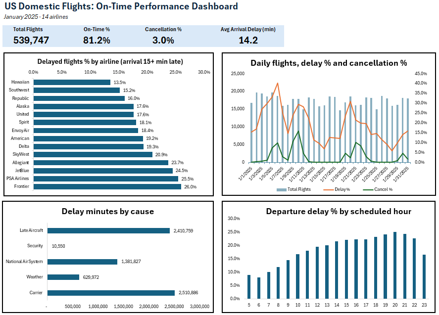
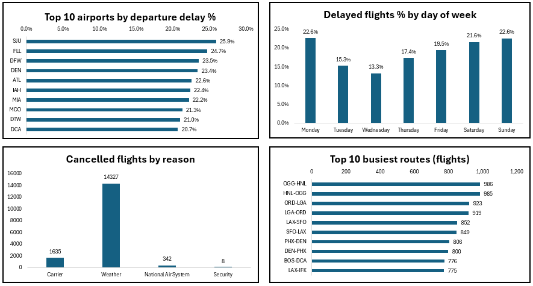

# ✈️ US Domestic Flights: On-Time Performance Analysis (Excel)

An end-to-end data analysis project on **539,747 US domestic flights (January 2025)**, built in Excel with Power Query, the Data Model, DAX measures and PivotTables, and presented in an 8-chart dashboard.




---

## 📌 Business Problem
Flight delays and cancellations cost passengers time and cost airlines money and reputation. This project answers:

1. How reliable were US domestic flights overall?
2. Which airlines, airports, routes, days and hours perform best and worst?
3. What causes delays, and what causes cancellations?
4. What actions could airlines, airports and travellers take to reduce the impact?

---

## 📊 Key Metrics
| Metric | Definition | Result |
|---|---|---|
| Total Flights | Count of scheduled flights | 539,747 |
| Cancel % | Cancelled flights ÷ all flights | 3.0% |
| Completed Flights | Flights not cancelled or diverted | 522,269 |
| Delay % | Flights arriving 15+ minutes late ÷ completed flights | 18.8% |
| On-Time % | 1 − Delay % | 81.2% |
| Avg Arrival Delay | Average arrival delay in minutes (completed flights) | 14.2 min |
| Dep Delay % | Departures 15+ minutes late ÷ flights that departed | used by hour and airport |

All metrics are DAX measures in the Excel Data Model.

---

## 🖥️ Dashboard Features
- **4 KPI tiles** (Total Flights, On-Time %, Cancellation %, Avg Arrival Delay), linked to the pivot tables with GETPIVOTDATA
- **8 charts:**
  1. Delayed flights % by airline
  2. Daily flights, delay % and cancellation % (combo chart)
  3. Delay minutes by cause
  4. Departure delay % by scheduled hour
  5. Top 10 airports by departure delay %
  6. Delayed flights % by day of week
  7. Cancelled flights by reason
  8. Top 10 busiest routes
- Charts are built from PivotTables on the Data Model, so every number comes from the full 539,747 rows
- A separate **Insights** sheet with findings and recommendations

---

## 🗂️ Dataset
- **Source:** US Department of Transportation, Bureau of Transportation Statistics (BTS), On-Time Reporting data, January 2025
- **Size:** 539,747 rows × 30 columns, 14 airlines, 329 origin airports
- **Main columns:** flight date, airline, origin and destination, scheduled and actual times, departure and arrival delay, cancellation flag and reason, diversion flag, distance, and five delay-cause columns (carrier, weather, NAS, security, late aircraft)
- The CSV (about 91 MB) is not included in this repository. Download it from the BTS TranStats website.

### Data preparation (Power Query)
- Set data types: `FL_DATE` parsed with the US locale; times kept as text so `0659` keeps its leading zero
- Checked for duplicates: **none found**
- Checked missing values: blank delay values belong to cancelled (16,312) or diverted (1,166) flights, and delay-cause fields are only filled for flights that arrived 15+ minutes late. Blanks were **kept on purpose** instead of being replaced with 0, so averages cover only flights that actually arrived.
- Added columns: `DEP_HOUR`, `ROUTE`, `COMPLETED`, `AIRLINE` (airline names from codes)

---

## 🔍 Key Insights
1. **81.2%** of completed flights arrived on time; **3.0%** of flights were cancelled.
2. **Hawaiian** had the lowest delay rate (13.5%), followed by Southwest (15.2%) and Republic (16.0%). **Frontier** had the highest (26.0%), followed by PSA Airlines (25.5%) and JetBlue (24.5%).
3. **PSA Airlines** had the most cancellations: 9.0% of its flights, against 3.0% overall.
4. Delays build through the day: **8.1% at 6 am to 25.0% at 8 pm**.
5. A few storm days drove the disruption: **6 Jan** had 40.2% of flights delayed and **10 Jan** had 16.0% cancelled.
6. **Weather caused 87.8%** of cancellations (14,327 of 16,312); carrier issues caused 10.0%.
7. **Carrier issues (36.2%) and late-arriving aircraft (34.7%)** account for about 71% of delay minutes; NAS 19.9%, weather 9.1%, security 0.2%.
8. Among airports with 3,000+ flights, **San Juan (25.9%), Fort Lauderdale (24.7%) and Dallas/Fort Worth (23.5%)** had the highest departure delay rates; **New Orleans** had the highest cancellation rate (10.0%).
9. **Monday and Sunday** had the highest delay rate (22.6%); **Wednesday** the lowest (13.3%).
10. The busiest routes are the Hawaii inter-island routes **OGG-HNL (986)** and **HNL-OGG (985)**; among the top 10, ORD-LGA has the highest delay rate (22.1%).

---

## ✅ Recommendations
| For | Recommendation |
|---|---|
| Travellers | Book morning departures and avoid days with winter-weather warnings; delay rates are about three times higher in the evening |
| Airlines | Reduce carrier-caused delays and late-arriving aircraft (about 71% of delay minutes) by adding schedule buffer for aircraft that fly many legs a day |
| PSA, Frontier, JetBlue | Review operations to find the root causes of high delay or cancellation rates |
| Airports | Prioritise de-icing, ground handling and staffing at the airports with the highest delay and cancellation rates |
| Operations teams | Prepare contingency plans for storm days, since a few days caused most cancellations |

**Limitation:** the data covers one winter month, so weather effects are strong and the day-of-week pattern partly reflects which storm days fell on which weekday. A full year would separate seasonal from structural effects.

---

## 📁 Project Structure
```
flight-ontime-analysis
├── Flight_OnTime_Analysis.xlsx  
├── Dashboard-1.png               
├── Dashboard-2.png               
└── README.md
```

**Workbook sheets:** Dashboard · Insights · Kpis · Airline · Daily_Trend · Delay_Causes · Hourly · Top_Airports · Cancellations · Weekday · Routes

---

## ▶️ How to Run
**View the finished project**
1. Download `Flight_OnTime_Analysis.xlsx` from this repository.
2. Open it in **Excel for Windows (desktop)**. It opens on the Dashboard.
3. Use the other tabs to see each pivot table. The data is already loaded in the file's Data Model, so you do not need the CSV. If Excel asks for the CSV when you press **Refresh All**, you can ignore it.

**Rebuild it from scratch**
1. Download the January 2025 on-time CSV from the BTS TranStats website.
2. In Excel: **Data > Get Data > From Text/CSV**, choose **Transform Data**.
3. In Power Query set the data types (`FL_DATE` with the English (United States) locale, `CRS_DEP_TIME` as text) and add the columns `DEP_HOUR`, `ROUTE`, `COMPLETED` and `AIRLINE`.
4. Choose **Close & Load To… > Only Create Connection > Add this data to the Data Model**.
5. Add the DAX measures (Total Flights, Cancel %, Delay %, On-Time %, Avg Arrival Delay and others) and build the PivotTables and charts.

**Requirements:** Microsoft Excel 2016 or later (desktop) with Power Query and the Data Model. Excel for the web has limited support for the Data Model.

---

## 🛠️ Tools
Excel · Power Query · Data Model · DAX · PivotTables · PivotCharts

## 👩‍💻 Author
**Nandhini** · [LinkedIn](https://linkedin.com/in/nandhini2565) · [GitHub](https://github.com/itznandyyy)
